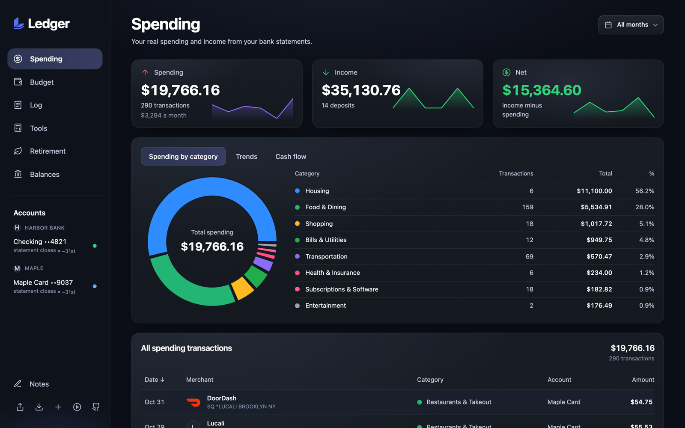

# Ledger

Financial planning that doesn't oversimplify you. Ledger reads your bank statements and turns them into a budget, a running log and a retirement plan that all agree with each other. No bank connections and no accounts. Ledger never sees your statements: they go only to the AI assistant you choose, and everything else stays on your computer.

**[Try it at ledgerfinancialplanning.com](https://ledgerfinancialplanning.com)** · [Video tutorial](https://ledgerfinancialplanning.com/tutorial)



You download your statements, give them to an AI assistant (Claude, ChatGPT, Codex or similar), and it turns them into one file. Ledger reads that file and shows you where your money goes.

## Why Ledger exists

Most money apps are too simple. They show a spending chart and a monthly budget, and that is where they stop.
Real planning has more moving parts, and they depend on each other:

- Your paycheck is not your salary. Take-home pay has to account for a 401k deferral that lowers income tax but
  not FICA, medical premiums that lower both, and an employer match that never shows up in your deposit.
- Each debt has its own balance, rate and monthly payment, and the month it is paid off, that payment frees up
  and should start going somewhere.
- Subscriptions come and go. The budget should notice when one stops charging and when it quietly comes back.
- Whatever is left after the bills has to be assigned on purpose: how much to savings, how much to spend.
- One-time events change everything downstream: a house down payment, paying off a car, a stock payout that
  only arrives while you still work, Social Security that starts at a claim age you choose.
- A 401k and a savings account are not the same money. One is locked until 60, and a retirement plan that adds
  them together hides the years you could run out of spendable cash.

Ledger connects all of it. Statements feed the Spending view, Spending feeds the Budget, the Budget's income and
leftover feed the Tools and the Retirement plan, and Balances feed both. Change your salary in Take-home pay and
the Budget, Rent scenarios and the Retirement projection all move. Link a debt to its Budget row and the payoff
date in Debt payoff, the freed payment in Retirement and the Balances page all agree. The plan for forty years
from now starts from what is true this month.

The goal is ambitious: a financial planning tool that is not afraid to get complex, in a form that is still easy
to use.

## What you get

- **Spending**: your real income and spending by month and category, with trends and cash flow.
- **About you**: your age, filing status and tax state, set once for every page that plans.
- **Budget**: a plan for the month, compared against what you actually spent. Subscriptions fill in on their own.
- **Log**: a running count of what you spend between statements, so you know if you are on track.
- **Tools**: calculators for take-home pay, rent, debt payoff, vacations and more.
- **Retirement**: a projection of your savings that finds the age you can stop working.

## How it works

1. Download your statements from your bank. PDF or CSV, any bank.
2. Open your AI assistant (Claude, ChatGPT, Codex or similar), attach the statements and paste the import prompt (it is in [IMPORT_PROMPT.md](IMPORT_PROMPT.md) and behind a button in the app).
3. The assistant gives you `ledger-data.json`. Upload it to Ledger.

Ledger keeps everything in that one file. When you set up your budget and plans, Export data saves them into the same `ledger-data.json`, next to your statements. There is no second file.

Next month, click Export data to save your latest `ledger-data.json`. Give that file to your assistant with the new statements and the import prompt. It adds the new month, keeps your budget and plans exactly as they are and gives you back the whole file. Upload it, and it replaces what Ledger had stored. Use Export data any time you want a backup.

## Two ways to run it

**In your browser.** Open [ledgerfinancialplanning.com/app](https://ledgerfinancialplanning.com/app) and upload your file. Your statements and numbers are stored in your browser and are not uploaded anywhere. Clearing your browser data clears it, so use Export data now and then. It saves one `ledger-data.json` with your statements, budget and settings, and uploading it brings everything back.

**On your computer.** Clone the repo and run it. A coding assistant such as Claude Code or Codex can read your statements folder and write the data files for you, and nothing is lost when you clear your browser.

```bash
git clone https://github.com/itstoyboxlabs/ledger.git
cd ledger/app
npm install
npm run dev
```

Then put your statements in a `statements/` folder and tell your coding assistant to import them. It follows the same rules as the import prompt. In this mode your budget and settings are saved as files in the data folder, and Export data still saves everything to one `ledger-data.json` if you want a backup.

By default your data files go in a `data/` folder next to `app/`. To keep them somewhere else, such as your Documents folder, create `app/.env.local` with the path:

```
LEDGER_DATA_DIR=~/Documents/Ledger/data
```

Git ignores `data/`, `statements/` and `.env.local`, so none of it is ever committed.

## Merchant logos

Ledger shows a logo next to each merchant it recognizes and the merchant's first letter for the rest.

- **On the website**, logos come from a catalog of about 3,400 common US merchants (grocery, restaurants, transit, airlines, streaming, utilities, banks and more), listed in [`app/scripts/icon-domains.txt`](app/scripts/icon-domains.txt). A merchant matches by the website domain in your file's `merchants` map, or by its name ("Uber", "UBER *TRIP" and "Uber Eats" all work). The app downloads the catalog's list once, after the page has drawn, from Ledger's own file storage. That request is the same for everyone, so it says nothing about which merchants you have. The import prompt points your assistant at the same list, so the names it writes match.
- **On your computer**, `bash scripts/fetch-icons.sh` downloads a logo for every domain in your `merchants` map into `app/public/icons/`, so merchants outside the catalog get one too.

To add merchants to the catalog, add a line to `icon-domains.txt` and see "Merchant icons" in [DOCS.md](DOCS.md).

## Privacy

Your statements are only ever read by the assistant you choose, the same way any file you attach to a chat is. Ledger does not upload your statements or the values you enter. The hosted site sends usage details only: which page and tool is used, a random session ID and crash messages. That is for product design, analytics and making sure the app works well. No personal information and no entered values are sent. You can read all of the code to check.

## Built with

React, TypeScript-ready Vite, Tailwind, shadcn/ui and Zustand. Charts use Recharts. The landing page and tutorial are part of the same React project and are prerendered at build time.

## Contributing

See [CONTRIBUTING.md](CONTRIBUTING.md). Adding a new calculator to the Tools page is a good first change.

Code is organized by feature with one thing per file. See [CODING_PATTERNS.md](CODING_PATTERNS.md) before adding code.

## License

MIT. See [LICENSE](LICENSE).
